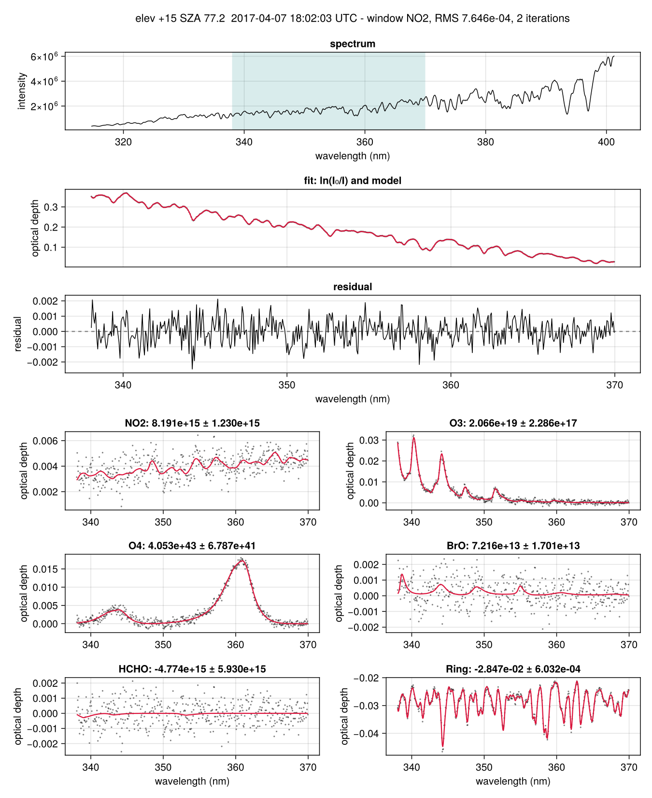
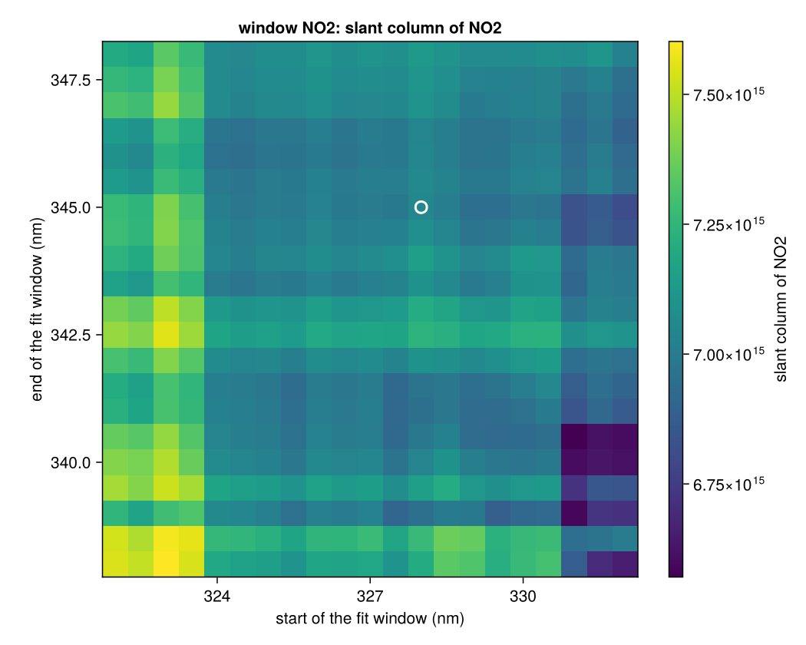
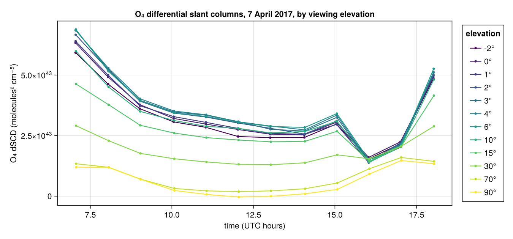

# MiniDOAS.jl

**Differential Optical Absorption Spectroscopy in Julia: read and write DOAS files, prepare
cross sections, fit spectra with QDOAS's algorithm to floating-point precision - from a
QDOAS project or straight from Julia - and explore the results in a local web GUI.**

* **Fit spectra exactly as QDOAS does.** The optical-density fit of
  [QDOAS](https://uv-vis.aeronomie.be/software/QDOAS/) (BIRA-IASB and S[&]T), ported routine by
  routine: slant columns agree with QDOAS to a median of 10⁻⁹-10⁻¹¹ of their errors, one to two
  orders of magnitude faster, in parallel on all cores.
* **With or without QDOAS.** Run the QDOAS project files (`.xml`) you already have, or describe
  the fit in a few lines of Julia (`FitWindow`, `CrossSection`, `ShiftStretch`) and fit spectra
  from any source - and write the same analysis back out as a QDOAS project.
* **Work with DOAS files.** MFC STD spectra (read and write), references, cross sections,
  calibrations, QDOAS projects, QDOAS-layout NetCDF results (write and read), CSV, and tables
  that go straight into DataFrames.
* **Prepare what a fit needs.** Slit functions and convolution, I₀-corrected cross sections,
  Ring spectra (QDOAS's algorithm), air/vacuum wavelengths, a wavelength and slit calibration
  against the solar spectrum, smoothing and differential spectra, simulated spectra with known
  slant columns.
* **Geometry.** Solar zenith and azimuth angles, geometric air mass factors and MAX-DOAS
  vertical columns.
* **Look at it.** Fit-window maps (retrieval interval mapping), publication figures with
  Makie, and a local web GUI to step through spectra and drag the fit window.

MiniDOAS.jl grew out of [QDOASJulia](https://github.com/mahantsunandan/QDOAS_Julia), the Julia port of
the QDOAS analysis core: it contains that port unchanged (verified bit for bit, see
[Accuracy](#accuracy)) and builds a general DOAS toolkit around it. *Mini* because it is a
compact DOAS package built on a port of part of QDOAS, not all of it.

```julia
using MiniDOAS
r = analyze("station.xml", "spectra/S0000001.STD")     # one spectrum, with a QDOAS project
batch = analyze("station.xml", "spectra/*.STD")        # many spectra, in parallel
no2, err = slant_column(batch, "NO2")
```

---

## Contents

1. [Credits and relationship to QDOAS](#credits-and-relationship-to-qdoas)
2. [Installation](#installation)
3. [Quick start](#quick-start)
4. [One spectrum or many files](#one-spectrum-or-many-files)
5. [Fitting from Julia](#fitting-from-julia)
6. [QDOAS projects](#qdoas-projects) — [command line](#command-line)
7. [DOAS files](#doas-files)
8. [Preparing cross sections and references](#preparing-cross-sections-and-references)
9. [Solar geometry and air mass factors](#solar-geometry-and-air-mass-factors)
10. [Results: tables, NetCDF, figures](#results-tables-netcdf-figures)
11. [Fit-window maps](#fit-window-maps)
12. [The web GUI](#the-web-gui)
13. [Which QDOAS options are supported](#which-qdoas-options-are-supported)
14. [How it works](#how-it-works)
15. [Accuracy](#accuracy)
16. [Speed](#speed)
17. [Behaviour inherited from QDOAS](#behaviour-inherited-from-qdoas)
18. [Examples, tests and repository layout](#examples-tests-and-repository-layout)
19. [References](#references)
20. [License and author](#license-and-author)

---

## Credits and relationship to QDOAS

**QDOAS** is developed at the Royal Belgian Institute for Space Aeronomy (**BIRA-IASB**) and
**S[&]T**, and is free software under a BSD-3-Clause license
(<https://uv-vis.aeronomie.be/software/QDOAS/>, source at
<https://github.com/UVVIS-BIRA-IASB/qdoas>). The fitting algorithm of MiniDOAS.jl is theirs: it was
written by reading the QDOAS 3.7.5 source code and reproducing the analysis routine by routine
(see [NOTICE.md](NOTICE.md)); the fitting code is unchanged in QDOAS 3.7.13. The Ring algorithm
and its Raman line tables are QDOAS's too.

MiniDOAS.jl is **independent work**. It is not affiliated with, reviewed or endorsed by BIRA-IASB or
S[&]T; please report problems with it here, not to the QDOAS team. QDOAS does far more than the
fit reproduced here (satellite and many ground-based formats, the full Kurucz calibration, AMFs,
...); for QDOAS projects MiniDOAS.jl covers the ground-based optical-density analysis described
[below](#which-qdoas-options-are-supported) and refuses anything else rather than approximating
it.

If you use MiniDOAS.jl in published work, please cite QDOAS (see [References](#references)) as well
as this repository.

---

## Installation

MiniDOAS.jl needs **Julia 1.10 or newer** (developed with Julia 1.12) on Windows, macOS or Linux.
Install Julia with [juliaup](https://julialang.org/install/), then, in Julia:

```julia
import Pkg
Pkg.add("MiniDOAS")                                              # once registered in Julia's General registry
Pkg.add(url="https://github.com/mahantsunandan/MiniDOAS.jl")     # straight from GitHub
Pkg.develop(path="path/to/MiniDOAS.jl")                          # a local copy you are working on
```

Then `using MiniDOAS`.

The core needs only Julia's standard libraries. Optional features load with other packages
(Julia [package extensions](https://pkgdocs.julialang.org/v1/creating-packages/#Conditional-loading-of-code-in-packages-(Extensions))):

| feature | load | install once |
|---|---|---|
| QDOAS-layout NetCDF (`write_netcdf`, `read_qdoas_netcdf`) | `using NCDatasets` | `Pkg.add("NCDatasets")` |
| the web GUI (`serve_gui`) | `using HTTP, JSON3` | `Pkg.add(["HTTP", "JSON3"])` |
| figures (`plot_fit`, `plot_window_map`) | `using CairoMakie` (or another Makie backend) | `Pkg.add("CairoMakie")` |

NetCDF and HDF5 come as prebuilt binaries with NCDatasets: nothing needs to be installed on the
system besides Julia. Calling an optional function without its packages says which ones to load.

To run the examples, tests and command line from a copy of this repository:

```bash
git clone https://github.com/mahantsunandan/MiniDOAS.jl.git
cd MiniDOAS.jl
julia --project -e "using Pkg; Pkg.instantiate(); Pkg.add([\"NCDatasets\", \"HTTP\", \"JSON3\"])"
julia --project -t auto -e "using Pkg; Pkg.test()"
```

---

## Quick start

**From a QDOAS project** - the `.xml` file you saved in the QDOAS GUI:

```julia
using MiniDOAS
p = parse_config("my_station.xml")             # read the project once

r = analyze(p, "spectra/S0000001.STD")         # one spectrum, every analysis window
print_summary(r)                               # RMS, χ², iterations, slant columns ± errors, shifts
slant_column(r, "NO2")                         # (NO2 slant column, its 1σ error)

batch = analyze(p, "spectra/*.STD")            # many spectra, in parallel with julia -t auto
batch = analyze_spectra(p)                     # ... or every spectrum the project lists
write_csv("results.csv", batch)
```

**From Julia, without QDOAS:**

```julia
using MiniDOAS
λ, I0 = read_reference("zenith_noon.ref")                   # wavelength (nm) and intensity
no2 = read_cross_section("no2_294K_convolved.xs"; name="NO2")
o4 = read_cross_section("o4_293K_convolved.xs"; name="O4")
ring = read_cross_section("ring.xs"; name="Ring")

window = FitWindow("NO2", 338.0, 370.0, [no2, o4, ring]; polynomial=5, linear_offset=1,
                   shifts=ShiftStretch("Spectrum"; stretch=1))
model = DOASModel(λ, I0, window)                            # set up once ...

r = doas_fit(model, "spectra/20170407_120237_e+10.STD")    # ... fit one spectrum
batch = doas_fit(model, "spectra/*.STD")                    # ... or a whole folder, in parallel
no2, err = slant_column(batch, "NO2")                       # NO2 and its error, per spectrum
```

**The examples** (from a copy of the repository):

```bash
julia --project -t auto examples/quickstart.jl       # a synthetic QDOAS project with known truth
julia --project -t auto examples/fit_from_julia.jl   # prepare, simulate and fit, all in Julia
julia --project -t auto examples/run_gui.jl          # the web GUI
```

`examples/quickstart.jl` writes a synthetic data set (SO₂ plume, O₃, NO₂, Ring, a wavelength
drift, broadband attenuation and photon noise; the cross sections are analytic shapes, **not
laboratory data**), fits it and compares with the truth:

```
spectrum        SO2 fitted ± error          SO2 true     NO2 fitted ± error        NO2 true
S0000001.STD   1.976e+16 ± 3.8e+14   2.077e+16    6.897e+15 ± 3.3e+14   6.959e+15
S0000006.STD   3.999e+17 ± 3.8e+14   3.999e+17    6.648e+15 ± 3.9e+14   6.282e+15
...
```

---

## One spectrum or many files

The two ways of fitting - with a QDOAS project (`analyze`) or with a model set up in Julia
(`doas_fit`) - take spectra the same way. **One spectrum gives a `DOASResult`; several give a
`DOASBatch`.**

| you pass | you get |
|---|---|
| a file: `"spectra/S0000001.STD"` | `DOASResult` |
| an `MFCSpectrum`, or a vector of intensities (`doas_fit`) | `DOASResult` |
| a pattern: `"spectra/*.STD"`, `"data/2017*.STD"` | `DOASBatch` |
| a folder: `"spectra"` (all its files; choose with `filter="*.STD"`, add sub-folders with `recursive=true`) | `DOASBatch` |
| a vector of files, of `MFCSpectrum`s or of intensity vectors, or a matrix (one spectrum per column) | `DOASBatch` |

```julia
using MiniDOAS
model = DOASModel(λ, I0, windows)                    # or p = parse_config("station.xml")

r = doas_fit(model, "spectra/S0000001.STD"; dark="dark.STD", offset="offset.STD")
batch = doas_fit(model, "spectra/*.STD"; dark="dark.STD", offset="offset.STD")
batch = doas_fit(model, "spectra"; filter="*.STD", recursive=true)
batch = analyze(p, ["spectra/a.STD", "spectra/b.STD"])

batch                                 # a summary: one line per spectrum, failures with their reason
batch["S0000001.STD"].result          # one spectrum's DOASResult (by file, or file name), or batch[1]
no2, err = slant_column(batch, "NO2") # a slant column and its error per spectrum (NaN where it failed)
t = measurement_time(batch)           # mid-exposure times (DateTime)
write_csv("results.csv", batch)       # the full table; results_columns(batch) for a DataFrame
write_netcdf("results/", batch)       # one QDOAS-layout NetCDF per spectrum (with NCDatasets)
```

```
DOASBatch: 144 spectra, 144 analysed, 0 failed in 0.67 s
  20170407_070244_e+00.STD NO2: NO2 1.391e+16 ± 1.6e+15, RMS 1.12e-03 | O4: O4 6.130e+43 ± 9.8e+41, RMS 1.07e-03
  ...
```

* **Spectrum files** are MFC STD spectra (recognised by the `.STD` extension or their layout), or
  plain text files of numbers - one column of intensities, or wavelength and intensity (the
  second column is used) - with one value per detector pixel of the model.
* **Dark and offset.** A QDOAS project applies its own dark and offset files. With `doas_fit`,
  pass `dark=` and `offset=` (files or `MFCSpectrum`s) for MFC STD spectra; they are removed as
  QDOAS removes them (`correct_dark_offset`).
* **Parallel and robust.** Batches run on all of Julia's threads (`julia -t auto`); a spectrum
  that cannot be read or fitted is recorded with its error and the others carry on.
  `on_progress=(done, total, file) -> ...` reports progress.
* `spectrum_files(path; filter, recursive)` shows which files a path names, without fitting them.

---

## Fitting from Julia

A fit is described by its analysis windows; a `DOASModel` puts them on the wavelength grid of the
spectra once, and `doas_fit` applies it to any number of spectra.

```julia
xs = CrossSection("NO2", "no2.xs")                  # from a file (first two columns) ...
xs = CrossSection("NO2", λ_lab, σ_lab)              # ... or from vectors (nm, cm² molecule⁻¹)

FitWindow(name, lmin, lmax, cross_sections;
          polynomial=3,             # order of the polynomial in (λ - λ₀), -1 for none
          linear_offset=-1,         # order of a linear intensity offset (radiance-normalised,
          linear_offset_ref=false,  #   or reference-normalised), -1 for none
          offset=-1,                # order 0-2 of a non-linear offset, -1 for none
          shifts=ShiftStretch[],    # shift and stretch groups, below
          gaps=[],                  # excluded intervals, e.g. [(355.0, 356.5)]
          lambda0=nothing)          # centre of polynomial and stretch (default: middle)

ShiftStretch("Spectrum"; stretch=1)                 # shift + 1st-order stretch of the spectrum
ShiftStretch("Ref", "NO2", "O3", "Ring")            # one shift shared by reference and cross sections
ShiftStretch("O4"; shift=false, shift_init=0.02)    # a fixed shift (nm)

model = DOASModel(λ, I0, [window1, window2]; interpolation=:spline, security_gap=10,
                  convergence=1e-4, max_iterations=0)
r = doas_fit(model, "S0000001.STD"; curves=true)    # a file, an MFCSpectrum or a vector of intensities
batch = doas_fit(model, "spectra/*.STD")            # files, a folder, a pattern or a matrix, in parallel
r = doas_fit(λ, spectrum, I0, window)               # set up and fit in one call
```

`doas_fit` returns a `DOASResult`; `r["NO2"]` (or `r[1]`) is the `WindowResult` of a window:

```julia
w = r["NO2"]
w.slcol["NO2"], w.slerr["NO2"]     # slant column and its 1σ error (also x0, x1, ..., offl0, ...)
w.rms, w.chisqr, w.niter           # fit quality, iterations
w.shift["Ref"], w.shift_err["Ref"] # shift (nm); an error of exactly 1 marks a value not fitted
w.stretch, w.params                # stretches; non-linear offsets (Offset0, ...)
w.residual                         # the residual (optical depth)
w.curves                           # with curves=true: λ, od, model, residual, components
```

A model built from Julia gives **bit for bit** the numbers of the same analysis run from a QDOAS
project (this is tested), so the two routes can be mixed freely: `DOASModel(parse_config("x.xml"))`
fits in-memory spectra with a QDOAS project, and `write_qdoas_project("x.xml", model)` writes a
Julia analysis as a project that QDOAS runs.

**Where to put the shift.** With noisy spectra, shift the noise-free vectors - the reference and
the cross sections, `ShiftStretch("Ref", "NO2", ...)` - rather than the measured spectrum.
Interpolating a noisy spectrum at a fraction of a pixel smooths its noise, which lowers χ² and
pulls the fitted shift towards half a pixel: in `examples/fit_from_julia.jl` a 0.010 nm drift
came out as -0.0170 ± 0.0010 nm when the spectrum was shifted (with slant column errors 1.6 times
too small), and as 0.0099 ± 0.0015 nm when the reference was. QDOAS behaves the same way.

---

## QDOAS projects

Set up the analysis in the **QDOAS GUI** as usual, check that it runs there, and save the
project (`File → Save`). MiniDOAS.jl uses that file as it is; paths in it must be valid on the
computer where MiniDOAS.jl runs. If the project uses an option MiniDOAS.jl does not reproduce exactly,
`parse_config` throws `UnsupportedConfig` naming it, instead of producing different numbers.

```julia
p = parse_config("myproject.xml")          # a ProjectSpec
p.spectra                                  # the spectra its "raw spectra" list
p.windows                                  # its analysis windows (FitWindows)

r = analyze(p, "S0000123.STD"; curves=true)  # one spectrum, dark- and offset-corrected as the project says
batch = analyze(p, "spectra/*.STD")        # several: files, a folder or a pattern (a DOASBatch)
batch = analyze_spectra(p)                 # every spectrum the project lists; never throws
model = DOASModel(p)                       # the project as a model, for spectra from elsewhere

write_qdoas_project("new.xml", windows; lambda=λ, reference="ref.ref", spectra="data/", filter="*.STD")
```

`analyze` throws `EngineError` where QDOAS itself would fail (a spectrum identical to its
reference, a non-positive intensity inside a window, ...). `analyze_spectra` records the error of a
bad spectrum and carries on.

### Command line

`bin/minidoas.jl` works like QDOAS's `doas_cl`:

```bash
julia --project=/path/to/MiniDOAS.jl -t auto /path/to/MiniDOAS.jl/bin/minidoas.jl -c myproject.xml -o results
```

| option | meaning |
|---|---|
| `-c, --config FILE` | QDOAS project file (required) |
| `-a, --project NAME` | project name inside the file; checked, as with `doas_cl -a` |
| `-f, --file SPECTRUM` | spectrum to analyse; repeat for several; wildcards such as `S*.STD` work on every OS. Default: all spectra listed in the project |
| `-o, --output DIR` | output directory (default `minidoas_output`) |
| `--csv FILE` | summary table (default `DIR/results.csv`) |
| `--no-netcdf` | write only the summary table |
| `-q, --quiet` | no progress messages |
| `--gui [FILE]` | open the web GUI instead (on the project FILE, if given) |
| `--port N`, `--no-browser` | with `--gui`: the port (default 8765), and not opening a browser |
| `-h`, `-V` | help, version |

It writes one QDOAS-layout NetCDF file per spectrum and `results.csv`. The exit status is 0 if
every spectrum was analysed, 1 if some failed (they are listed, and marked in the CSV), 2 for a
usage or project error. The project's *raw spectra* are expanded as QDOAS does: folders with
their filters (several separated by `;`), with or without sub-folders, single files and `%0`-`%9`
path placeholders; the dark, offset and calibration files are left out.

---

## DOAS files

| file | read | write |
|---|---|---|
| MFC STD spectrum | `read_mfc_std(path)` → `MFCSpectrum` | `write_mfc_std(path, s)` or `write_mfc_std(path, counts; name, start, stop, scans, exposure, elevation, ...)` |
| many spectra | `spectrum_files("spectra/*.STD")`, `spectrum_files(folder; filter, recursive)` | |
| reference (λ, I) | `read_reference(path)` → `(λ, I)` | `write_reference(path, λ, I)` |
| cross section | `read_cross_section(path; name)` → `CrossSection` | `write_cross_section(path, xs)` |
| wavelength calibration | `read_calibration(path)` → `λ` | `write_calibration(path, λ)` |
| any numeric columns | `read_columns(path)` | `write_columns(path, cols...; header)` |
| QDOAS project | `parse_config(path)` → `ProjectSpec` | `write_qdoas_project(path, windows or model; ...)` |
| QDOAS NetCDF results | `read_qdoas_netcdf(path)` | `write_netcdf(path, result)`, `write_netcdf(folder, batch)` |
| results table | | `write_csv(path, batch)`, `results_columns(batch)` |

In text files, lines starting with `;`, `#`, `*` or `%` are comments; columns are separated by
spaces, tabs or commas; numbers are written with every digit needed to read them back exactly.

**MFC STD spectra** are text files, one spectrum per file, read exactly as QDOAS reads them:

```
GDBGMNUP                 line 1: anything (not used)
1                        line 2: first pixel (not used)
1340                     line 3: number of pixels N
174501                   lines 4 .. N+3: the counts, one per line (summed over the scans)
...
elev +15 SZA 71.4        spectrum name (the first 20 characters are used)
My spectrometer          spectrometer name   (not used)
My telescope             scanning device     (not used)
04/07/2017               date, in the project's date format (default MM/DD/YYYY)
18:01:57                 start of the exposure, hh:mm:ss (UTC as recorded)
18:02:09                 end of the exposure; the reported time is the middle
0                        two numbers (not used)
0
SCANS 5                  optional: number of scans (used by the offset correction)
int_TIME 6.9             optional: exposure time in s (see "Behaviour inherited from QDOAS")
ExposureTime = 6902.4    optional "key = value" lines anywhere after the header:
ElevationAngle = 15        ExposureTime (ms), NumScans, ElevationAngle, AzimuthAngle,
Latitude = 42.21           Latitude, Longitude
```

An `MFCSpectrum` has the `counts`, `scans`, `exposure` (s), `name`, `date`, mid-exposure `time`,
`elevation`, `azimuth`, `latitude`, `longitude` and all `header` lines; `measurement_time(s)` is
the mid-exposure `DateTime`. `correct_dark_offset(s; dark, offset)` applies QDOAS's dark and offset
correction, `I = R - O·n_R/n_O - D·(n_R t_R)/(n_D t_D)`.

---

## Preparing cross sections and references

```julia
slit = GaussianSlit(0.45)                      # FWHM in nm; or a function of λ: GaussianSlit(λ -> ...)
# also BoxcarSlit(w), TriangularSlit(fwhm), LorentzianSlit(fwhm), TabulatedSlit(Δλ, value)

no2 = convolve(no2_lab, λ, slit)               # a CrossSection at the instrument's resolution on λ
I0 = convolve(solar_λ, solar, λ, slit)         # any high-resolution spectrum
o3 = convolve_i0(o3_lab, solar_λ, solar, λ, slit; scd=1e19)   # with the I₀ correction (Aliwell et al. 2002)
ring = CrossSection("Ring", λ, ring_spectrum(solar_λ, solar, λ, slit; temperature=250))

λvac = air_to_vacuum.(λair)                    # Edlén (1966) / Birch and Downs (1994); vacuum_to_air
cal = calibrate_wavelength(λ, zenith_counts, solar_λ, solar;
                           windows=[(318.0 + 10k, 328.0 + 10k) for k in 0:7],
                           absorbers=[o3.sigma])
cal.lambda, cal.fwhm_fit                       # calibrated grid; slit FWHM as a function of λ

smooth(y, 5; kernel=:binomial)                 # :boxcar, :triangular, :binomial, :gaussian
differential(λ, σ; order=3)                    # σ minus its polynomial: the differential part
simulate_spectrum(λ, I0, [no2, o4], [2e16, 4e43]; shift=0.01, polynomial=[0, -0.004], noise=:photon)
```

`calibrate_wavelength` finds, in each sub-window, the wavelength shift and Gaussian slit width
that best fit the solar spectrum to a measured one (with a polynomial and optional absorbers),
then smooth polynomials in λ through them - in the spirit of QDOAS's Kurucz calibration, not a
copy of it. `ring_spectrum` is QDOAS's Ring algorithm (rotational Raman scattering by N₂ and O₂,
Chance and Spurr 1997). `simulate_spectrum` makes spectra with known slant columns to test fit
settings. [`examples/ace_maxdoas/prepare.jl`](examples/ace_maxdoas/prepare.jl) uses all of these on
real spectra.

---

## Solar geometry and air mass factors

```julia
sp = solar_position(DateTime(2017, 4, 7, 12, 2, 33), 41.09, -12.18)   # UTC, latitude, longitude
sp.zenith, sp.azimuth, sp.elevation, sp.declination, sp.equation_of_time
solar_position(s::MFCSpectrum)                 # from a spectrum's time and position
geometric_amf(15)                              # 1/sin(α): MAX-DOAS, tropospheric absorber
sza_amf(60)                                    # 1/cos(θ): direct sun
geometric_vcd(dscd, 30)                        # dSCD / (1/sin α - 1), the geometric approximation
results_table(batch; sza=true)                 # adds the solar zenith angle to the table
```

The solar position uses the NOAA solar calculator's algorithm (after Meeus, about 0.01°); pass
`refraction=true` for the apparent position.

---

## Results: tables, NetCDF, figures

```julia
write_csv("results.csv", batch)                # one row per spectrum
cols = results_columns(batch)                  # a Tables.jl column table:
using DataFrames; df = DataFrame(cols)         #   DataFrame(cols), CSV.write("x.csv", cols), ...

using NCDatasets
write_netcdf("S0000123.nc", r)                 # QDOAS's NetCDF layout
q = read_qdoas_netcdf("qdoas_results.nc")      # QDOAS's (or MiniDOAS.jl's) NetCDF results
q.windows["NO2"]["SlCol(NO2)"]

using CairoMakie
fig = plot_fit(analyze(p; spectrum=f, curves=true); window="NO2")
save("fit.png", fig)
```

The table has `file, name, date, time, status, error`, the viewing `elevation`, `azimuth`,
`latitude` and `longitude` when the spectra give them (and `sza` on request), then for each window
`Window.RMS`, `Window.Chi2`, `Window.iterations`, `Window.SlCol(X)` and `Window.SlErr(X)` for every
fitted term (cross sections, then polynomial `x0, x1, ...`), shifts, stretches and offsets with
their errors. Slant columns are in the units of the cross sections times length (molecules cm⁻²
for cross sections in cm² molecule⁻¹); shifts in nm.

`write_netcdf` writes QDOAS's NetCDF-4 layout: a group named after the project's *swath name*
(default `QDOAS Results`) with the record fields (`Name`, `Date (DD-MM-YYYY)`, `Time (hh:mm:ss)`),
one sub-group per analysis window with QDOAS's variables in QDOAS's order (`Chi`, `RMS`, `iter`,
`processing_error`, `residual_spectrum`, `SlCol(X)`, `SlErr(X)`, shifts and stretches, polynomial,
offsets), QDOAS's types and fill values. Programs that read QDOAS's NetCDF output read these files
unchanged; the attribute `Qdoas` says that MiniDOAS.jl wrote them.

`plot_fit` draws the measured spectrum with the fit window, the optical depth with the model, the
residual, and one panel per absorber (its fitted optical depth against the measured one,
absorber plus residual), with the slant columns.

<p align="center"></p>

*`plot_fit` on a real MAX-DOAS spectrum (ACE expedition, 7 April 2017, 18:02 UTC, 15° elevation;
the [real-data example](examples/ace_maxdoas/)): the NO₂ window with NO₂, O₃, O₄, BrO, HCHO and
Ring, fitted in 2 iterations to an RMS of 7.6 × 10⁻⁴.*

---

## Fit-window maps

```julia
m = fit_window_map(model, spectrum; window="NO2", starts=330:1.0:346, ends=362:1.0:378)
m["NO2"]         # slant column per (start, end); also "err:NO2", "rel:NO2", "rms", "chi2", "iterations"
m.results[i, j]  # the WindowResult of a cell (nothing where too narrow or failed: m.errors[i, j])
plot_window_map(m, "NO2")
fit_window_map(parse_config("x.xml"), "S0000123.STD"; window=1, starts=..., ends=...)
```

Every cell is the window fitted with that interval and all its other settings (*retrieval
interval mapping*, Vogel et al., 2013): a good fit window is one where the result changes little
when the window moves a little. Cells are fitted in parallel.

<p align="center"></p>

---

## The web GUI

```bash
julia --project -t auto bin/minidoas.jl --gui myproject.xml
julia --project -t auto examples/run_gui.jl            # an example
```

or `using MiniDOAS, HTTP, JSON3; serve_gui(project="myproject.xml")`. It starts a small web server on
your own computer and opens **http://127.0.0.1:8765/** in your browser. The page has no external
resources, so it works offline:

* **Open a QDOAS project** (<kbd>Ctrl</kbd>+<kbd>O</kbd>) or a folder of spectra
  (<kbd>Ctrl</kbd>+<kbd>Shift</kbd>+<kbd>O</kbd>); switch analysis windows on and off.
* **Fit** — select a spectrum and press <kbd>Enter</kbd>; <kbd>↑</kbd>/<kbd>↓</kbd> step through
  the spectra and fit each one. Per window: the spectrum with the fit window, the optical-density
  fit and residual, one panel per absorber, polynomial and offset, and every fitted quantity.
* **Play with the fit window** — drag it, type it, change the polynomial order or click absorbers
  out of the fit; with *live refit* the spectrum is fitted again in milliseconds, and each slant
  column shows its change in units of its error. <kbd>Ctrl</kbd>+<kbd>Z</kbd> undoes.
* **Fit window map** — the map above, in the page; click a cell to use that window.
* **Results** — every spectrum analysed with the current settings (one by one or with
  <kbd>Ctrl</kbd>+<kbd>Enter</kbd>, all in parallel): a chart against time, elevation or spectrum
  number, coloured by elevation for MAX-DOAS, and the table.
* **Export** — results as CSV, one spectrum as CSV or QDOAS-layout NetCDF, fitted curves as CSV,
  figures as SVG or PNG. **Save as…** writes your window changes to a new QDOAS project (the
  original is never overwritten); QDOAS opens it.

Press <kbd>?</kbd> for all keyboard shortcuts and <kbd>D</kbd> for dark mode. The GUI can read the
files your user account can read and writes the files you ask it to, so it only accepts
connections from the same computer and requests from its own page. Only use
`serve_gui(host="0.0.0.0")` on a network you trust.

---

## Which QDOAS options are supported

For QDOAS projects, MiniDOAS.jl reproduces the **ground-based optical-density fit** of QDOAS. Everything
in this table is implemented and validated; anything else raises `UnsupportedConfig` with the name
of the option, so you never get silently different numbers. (The same options are available from
Julia through `FitWindow`.)

| QDOAS setting | supported |
|---|---|
| Analysis method | Optical density fitting (`ODF`), no fit weighting, wavelength unit nm |
| Instrument file format | MFC STD (`mfcstd`), with dark and offset files, spectrum reversal |
| Interpolation | cubic spline or linear |
| Reference | from a file (`refsel="file"`), one reference per window |
| Cross sections | used as they are, or interpolated to the calibration grid |
| Polynomial | order 0–8 in (λ − λ₀) |
| Linear offset | order 0–8, radiance- or reference-normalised |
| Non-linear offset | orders 0, 1 and 2, fitted or fixed |
| Shift and stretch | on *Spectrum*, *Ref* or groups of cross sections; shift fitted or fixed, with limits; stretch of 1st or 2nd order |
| Gaps | yes |
| Several analysis windows | yes; disabled windows are skipped |
| Outputs | name, date, time, RMS, χ², iterations, error flag, residual; SCD, SCD error and scaling factor per cross section; shifts, stretches, offsets, polynomial |

**Not implemented in the fit** (use QDOAS): other file formats (satellite, ASCII, other
ground-based formats), the Marquardt+SVD method and instrumental fit weighting, QDOAS's own Kurucz
calibration inside the analysis, automatic reference selection and a second reference, convolution
inside the analysis (convolve beforehand with `convolve`), orthogonalisation, AMFs and vertical
columns in the project, fixed or constrained concentrations, molecular ring / undersampling /
Raman / common-residual non-linear terms, low- and high-pass filters, stray-light correction, and
spike removal (the default tolerance, 999.9, is fine; a spectrum that would actually trigger it is
refused).

---

## How it works

**The physics.** Light passing through the atmosphere is attenuated by the Beer–Lambert law,

$$ I(\lambda) = I_0(\lambda)\, \exp\!\Big(-\sum_i \sigma_i(\lambda)\, S_i\Big)\, B(\lambda), $$

with $I_0$ the light without the absorbers (the **reference**), $\sigma_i$ the absorption **cross
section** of gas $i$, $S_i=\int n_i\,ds$ its **slant column density** (SCD), and $B$ everything that
varies slowly with wavelength (Rayleigh and Mie scattering, surface and instrument). In optical
depth this is linear,

$$ \tau(\lambda) = \ln \frac{I_0(\lambda)}{I(\lambda)} = \sum_i \sigma_i(\lambda)\, S_i + P(\lambda), $$

with the broadband part absorbed by a low-order **polynomial** $P$; the narrow-band "differential"
structure of each gas identifies it and gives its column. With a measured reference the columns
are differential SCDs. Real spectra need more terms: the **Ring effect** (rotational Raman
scattering filling in Fraunhofer lines; fitted as a pseudo-absorber), **wavelength shift and
stretch** of spectrum, reference or cross sections, and **intensity offsets** (inside the
logarithm, or as a linear term).

**The numerical method** (QDOAS's, followed step by step; QDOAS routine names in brackets):

1. **Spectrum** (`MFC_ReadRecordStd`, `MFC_LoadOffset/Dark`): offset and dark current removed,
   scaled by scans and exposure time.
2. **Normalisation**: spectrum and reference divided by their Euclidean norms; the constant ends
   up in the polynomial's constant term and is removed again when the polynomial is reported.
3. **Fitting interval** (`FNPixel`, `ANALYSE_LoadGaps`): the pixels inside the window minus the
   gaps; a *security gap* of pixels (default 10) is kept on both sides for shifted vectors; λ₀ is
   the window's centre unless set.
4. **Cross sections** interpolated to the calibration grid with a natural cubic spline (or
   linearly) unless already on it (`SPLINE_Deriv2`, `SPLINE_Vector`).
5. **The model** for given non-linear parameters $p$ (`ANALYSE_Function`, `ShiftVector`): each
   shifted vector $v$ is evaluated with its spline at
   $\lambda - \Delta - s_1(\lambda-\lambda_0) - s_2(\lambda-\lambda_0)^2$ (stretches internally scaled for
   conditioning); a non-linear offset is removed from the shifted spectrum; the optical depth
   $y = \ln \tilde I_0 - \ln \tilde I$ is fitted by the **linear model**
   $y = \sum_i S_i \tilde\sigma_i + \sum_k a_k(\lambda-\lambda_0)^k\,[+\sum_k b_k(\lambda-\lambda_0)^k g] + r$
   with the optional linear offset $g=-\langle\tilde I\rangle/\tilde I$ or $\langle I_0\rangle/I_0$;
   the linear parameters are the least-squares solution by Householder QR with column pivoting
   on unit-length columns (`LINEAR_decompose`, `LINEAR_solve`), with covariance $(A^\mathsf{T}A)^{-1}$
   from a Cholesky factorisation.
6. **Fit quality**: $\chi^2 = \sum r_j^2/(N - n_\text{lin} - n_\text{nonlin})$ and
   $\text{RMS}=\sqrt{\sum r_j^2/N}$.
7. **Non-linear parameters** (shifts, stretches, offsets) by **Levenberg–Marquardt** exactly as
   QDOAS's version of Bevington's `CURFIT`: forward-difference Jacobian with the project's steps
   (default 10⁻³), scaled normal matrix inverted by Gauss–Jordan elimination with full pivoting,
   λ from 10⁻³ (×10 after a worse step, ÷10 after a better one), steps ×0.4 after each pass,
   until $|\Delta\chi^2|/\chi^2$ is below the convergence criterion (default 10⁻⁴); errors
   $\sigma(p_j)=\sqrt{(\alpha'^{-1})_{jj}\chi^2/\alpha_{jj}}$.
8. **Results** (`ANALYSE_CurFitMethod`): $\sigma(S_i)=\sqrt{C_{ii}\chi^2}$; the polynomial reported
   for $\ln(I/I_0)$ as QDOAS does; parameters not fitted reported with an error of exactly 1;
   outputs divided by the scaling factor.

Every routine mirrors its QDOAS counterpart down to the order of floating-point operations where
that matters, which is why the results agree to rounding error rather than "closely".

---

## Accuracy

**MiniDOAS.jl against QDOASJulia.** MiniDOAS.jl contains the analysis of QDOASJulia, restructured to serve
both QDOAS projects and fits set up from Julia. On the synthetic data set and 15 project variants
(linear interpolation, first- and second-order stretch, radiance- and reference-normalised linear
offsets, non-linear offsets of orders 0-2, gaps, polynomials of order 0-5 and none, a set λ₀, a
fixed shift, shift limits, iteration limits, a smaller security gap), all 180 window fits are
**identical bit for bit** - slant columns, errors, shifts, stretches, offsets, residuals,
iterations and NetCDF variables - whether MiniDOAS.jl reads the project file or the same analysis is
set up in Julia with in-memory cross sections. Projects written by `write_qdoas_project` give the
same bits as the hand-written project of QDOASJulia's example. On the real-data example (144
MAX-DOAS spectra, two windows), MiniDOAS.jl and QDOASJulia agree bit for bit in all 288 window fits,
and the example's preparation rebuilt on MiniDOAS.jl's tools reproduces QDOASJulia's calibration digit
for digit (fitted parameters within 6.6 × 10⁻⁵ σ, from the number of digits written to files).

**QDOASJulia against QDOAS** (QDOAS 3.7.5 `doas_cl`, the same projects and spectra):

| data | result |
|---|---|
| field data: 168 spectra, 24 ground-based UV/visible instrument configurations, 686 windows, 7,016 slant columns | median 5.9 × 10⁻⁹ σ, 99th percentile 2.5 × 10⁻⁴ σ; iteration counts identical in 684 of 686 windows |
| the real-data example (144 ACE MAX-DOAS spectra, 288 window fits, 3,888 parameters) | median 3.5 × 10⁻¹¹ σ (maximum 3.3 × 10⁻⁷ σ), identical iteration counts, RMS equal to 2.6 × 10⁻¹² |
| the synthetic example (12 spectra, 168 slant columns) | median 1.2 × 10⁻¹² σ (maximum 1.9 × 10⁻¹⁰ σ), identical iteration counts |

(σ: QDOAS's own error of each slant column.) The two field-data windows that differ by up to
0.49 σ are poorly constrained (many absorbers with strongly correlated fitted shifts); there QDOAS
itself moves by up to 0.44 σ when its input spectrum changes by one part in 10¹³.

To compare with QDOAS on your own projects, set `QDOAS_DOAS_CL=/path/to/doas_cl` before
`Pkg.test()` (the synthetic project), or use QDOASJulia's `validation/compare_with_qdoas.jl`.

---

## Speed

Measured for QDOASJulia, whose analysis MiniDOAS.jl runs unchanged (Intel Core i7-12700H, Linux, QDOAS
3.7.5 `doas_cl`; same projects and spectra):

| | QDOAS `doas_cl` | 1 thread | 4 threads |
|---|---|---|---|
| real-data example (2 windows, 5–6 absorbers, 1340 pixels), one spectrum per run | 1.15 s | 6–12 ms | |
| same, all 144 spectra | 7.4 s | 0.41 s (2.8 ms per spectrum) | 0.18 s |
| synthetic project, each additional spectrum of a batch | 14 ms | 2.9 ms | 0.93 ms |
| field project (6 windows, up to 13 absorbers), each additional spectrum | 0.47 s | 55 ms | |

MiniDOAS.jl reads a project once and keeps the interpolated cross sections and references in memory
(re-read automatically if a file changes); spectra are independent, so batches run on all cores
(`julia -t auto`); and the analysis is compiled to native code with LAPACK/BLAS linear algebra. A
`DOASModel` goes further for live processing: set up once, it fits spectra already in memory
without touching any file. `examples/benchmark.jl` measures your computer. The first analysis in a
Julia session includes compilation (a few seconds); every later one takes milliseconds.

---

## Behaviour inherited from QDOAS

* **Dark current and `INT_TIME`.** QDOAS 3.7 reads the exposure time of MFC STD files from a line
  starting with `int_TIME` (lower-case "int") or an `ExposureTime =` entry. Many instruments write
  `INT_TIME`; QDOAS then reads an exposure time of 0 and skips the dark-current term, relying on the
  offset correction alone. MiniDOAS.jl does the same (and `write_mfc_std` writes `int_TIME`).
* **Polynomial sign.** The reported polynomial describes $\ln(I/I_0)$, and its constant term includes
  the normalisation constant.
* **Fixed parameters** are reported with an error of 1.
* **One record per NetCDF file**, as QDOAS writes for MFC STD data.
* **A spectrum identical to its reference** is an error.
* **Threads.** Batches set OpenBLAS to one thread while spectra are fitted in parallel (many small
  fits are faster that way). This can change slant column *errors* in the last bit (10⁻¹⁶
  relative), because $A^\mathsf{T}A$ is summed in a different order; serial runs are reproducible
  bit for bit.

---

## Examples, tests and repository layout

```
MiniDOAS.jl/
├── Project.toml              package description, dependencies and extensions
├── src/
│   ├── MiniDOAS.jl               module, exports, error types
│   ├── types.jl              CrossSection, ShiftStretch, FitWindow, ProjectSpec
│   ├── files.jl              MFC STD spectra, columns, references, calibrations, cross sections
│   ├── config.jl             QDOAS project files and their spectra
│   ├── numerics.jl           cubic splines, pixel search, normalisation
│   ├── fit.jl                the model function and the Levenberg–Marquardt fit
│   ├── results.jl            per-window results in QDOAS's conventions
│   ├── model.jl              DOASModel, doas_fit, analyze, batches
│   ├── mapping.jl            fit-window maps
│   ├── table.jl              tables, CSV, summaries
│   ├── qdoas_project.jl      writing and editing QDOAS project files
│   ├── tools.jl              slits, convolution, I₀ correction, Ring, air/vacuum, calibration, filters, simulation
│   ├── raman_tables.jl       rotational Raman lines (QDOAS)
│   ├── solar.jl              solar position, air mass factors
│   ├── extensions.jl         functions provided by the extensions
│   └── cli.jl                command line (bin/minidoas.jl)
├── ext/
│   ├── MiniDOASNetCDFExt.jl      QDOAS-layout NetCDF (NCDatasets)
│   ├── MiniDOASGUIExt.jl         web GUI server (HTTP, JSON3)
│   └── MiniDOASMakieExt.jl       figures (Makie)
├── gui/index.html            web GUI page (plain HTML/JavaScript, no external libraries)
├── bin/minidoas.jl               command-line entry point
├── examples/
│   ├── quickstart.jl         synthetic QDOAS project: fit, compare with the truth, write results
│   ├── fit_from_julia.jl     prepare, simulate and fit without QDOAS
│   ├── synthetic_data.jl     the synthetic data set (known truth) and its QDOAS project
│   ├── ace_maxdoas/          real MAX-DOAS spectra (CC BY 4.0) and prepare.jl
│   ├── run_gui.jl, benchmark.jl
├── test/runtests.jl          test suite
└── docs/                     README figures and the script that makes them
```

```bash
julia --project -t auto -e "using Pkg; Pkg.test()"
```

The tests (about 480) check that the true slant columns and shifts of the synthetic data are
recovered; that fits set up in Julia and from project files agree bit for bit, and with projects
written by `write_qdoas_project`; serial and parallel batches; the curves, CSV, tables and NetCDF
(written and read back); the command line; the file readers and writers; convolution with every
slit, the I₀ correction, air/vacuum wavelengths, smoothing, Ring spectra and the wavelength
calibration (which finds a known shift and slit width); simulated spectra (known columns
recovered, errors consistent with the scatter); the solar position (solstice and equinox
declinations, the equation of time, solar noon, the ACE spectra's own solar zenith angles); fit-
window maps; the GUI's editing and server; and that unsupported QDOAS options are refused. With
`QDOAS_DOAS_CL` set they also compare with QDOAS. The figures are tested separately, in an
environment with CairoMakie: `julia --project=<that environment> test/makie.jl`.

**Real-data example.** [`examples/ace_maxdoas/`](examples/ace_maxdoas/) holds 145 real MAX-DOAS
spectra from the Antarctic Circumnavigation Expedition (Benavent et al., 2020, CC BY 4.0);
`julia --project examples/ace_maxdoas/prepare.jl` downloads public cross sections and the solar
spectrum (about 7 MB), calibrates the instrument against the solar spectrum, convolves the cross
sections, computes a Ring spectrum and writes a QDOAS project with an NO₂ and an O₄ window
(details in [its README](examples/ace_maxdoas/README.md)). All 144 spectra fit in 0.7 s on four
threads; O₄ grows towards the horizon and gives, in the geometric approximation at 30°, an O₄
vertical column of 1.28-1.43 × 10⁴³ molecules² cm⁻⁵ around noon, as expected at sea level, and
NO₂ is stratospheric (1.1 × 10¹⁶ molecules cm⁻² in the zenith at SZA 84°) with no measurable
tropospheric NO₂ in this marine air.

<p align="center"></p>

---

## References

* **QDOAS** (please cite when you use MiniDOAS.jl): C. Fayt, T. Danckaert, M. Van Roozendael and
  J. Vlietinck (2026), *QDOAS trace gas retrieval software* (version 3.7.13) [computer software],
  Royal Belgian Institute for Space Aeronomy, <https://doi.org/10.18758/oqvqk2j3>. Source code:
  <https://github.com/UVVIS-BIRA-IASB/qdoas>.
* T. Danckaert, C. Fayt, M. Van Roozendael, I. De Smedt, A. Merlaud, G. Pinardi and J. Vlietinck,
  *QDOAS Software User Manual*, version 3.7.13, BIRA-IASB, 2026.
* U. Platt and J. Stutz, *Differential Optical Absorption Spectroscopy: Principles and
  Applications*, Springer, Berlin, 2008.
* J. P. Aliwell et al. (2002), Analysis for BrO in zenith-sky spectra: an intercomparison exercise
  for analysis improvement, *J. Geophys. Res.* 107, 4199, doi:10.1029/2001JD000329 (the I₀ correction).
* K. V. Chance and R. J. D. Spurr (1997), Ring effect studies: Rayleigh scattering, including
  molecular parameters for rotational Raman scattering, and the Fraunhofer spectrum, *Appl. Opt.*
  36, 5224–5230 (the Ring spectrum).
* L. Vogel, H. Sihler, J. Lampel, T. Wagner and U. Platt (2013), Retrieval interval mapping: a tool
  to visualize the impact of the spectral retrieval range on differential optical absorption
  spectroscopy evaluations, *Atmos. Meas. Tech.* 6, 275–299, doi:10.5194/amt-6-275-2013.
* B. Edlén (1966), The refractive index of air, *Metrologia* 2, 71–80; K. P. Birch and M. J. Downs
  (1994), Correction to the updated Edlén equation for the refractive index of air, *Metrologia*
  31, 315–316.
* J. Meeus, *Astronomical Algorithms*, Willmann-Bell, 1991; NOAA Global Monitoring Laboratory
  solar calculator (the solar position).
* G. Hönninger, C. von Friedeburg and U. Platt (2004), Multi axis differential optical absorption
  spectroscopy (MAX-DOAS), *Atmos. Chem. Phys.* 4, 231–254; E. J. Brinksma et al. (2008), The 2005
  and 2006 DANDELIONS NO₂ and aerosol intercomparison campaigns, *J. Geophys. Res.* 113, D16S46
  (geometric air mass factors).
* P. R. Bevington and D. K. Robinson, *Data Reduction and Error Analysis for the Physical
  Sciences*, McGraw-Hill (`CURFIT`); W. H. Press et al., *Numerical Recipes*, Cambridge University
  Press (cubic splines).
* Real-data example: N. Benavent, D. Garcia-Nieto, C. A. Cuevas and A. Saiz-Lopez (2020), raw
  MAX-DOAS spectra of the Antarctic Circumnavigation Expedition, Zenodo, doi:10.5281/zenodo.3827443
  (CC BY 4.0); cross sections and solar spectrum as listed in
  [examples/ace_maxdoas/README.md](examples/ace_maxdoas/README.md).

---

## License and author

**MiniDOAS.jl is open source and anyone may use it**, for any purpose including commercial work, modify
it and share it, as long as the copyright and license notices stay with the code.

| part | license |
|---|---|
| the code (`src/`, `ext/`, `bin/`, `gui/`, `examples/*.jl`, tools, tests) | BSD-3-Clause (this project, and QDOAS for the parts derived from it; see [NOTICE.md](NOTICE.md)) |
| the example spectra (`examples/ace_maxdoas/data/`) | CC BY 4.0 (Benavent et al. 2020): credit the data set if you redistribute them |
| cross sections, solar spectrum | not in the repository; downloaded by `prepare.jl`; cite their authors |

**Author:** Sunandan Mahant — <sunandanmahant@outlook.com>
